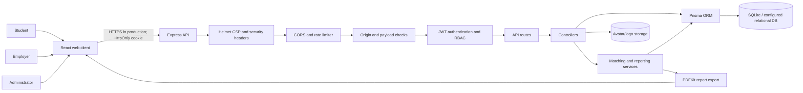
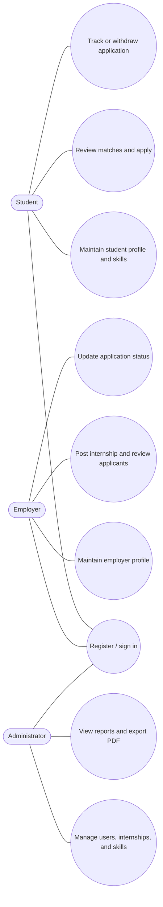
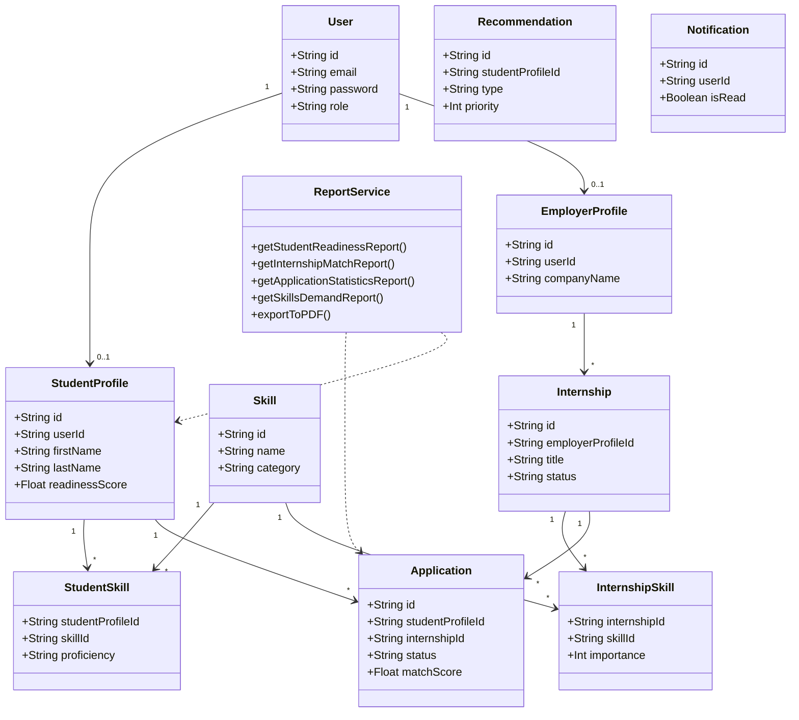
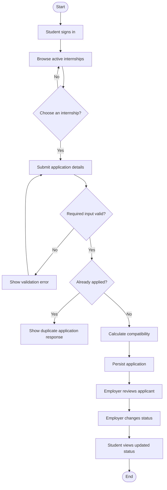
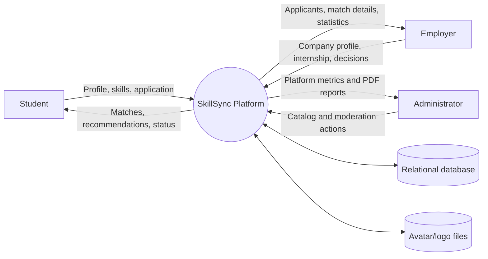
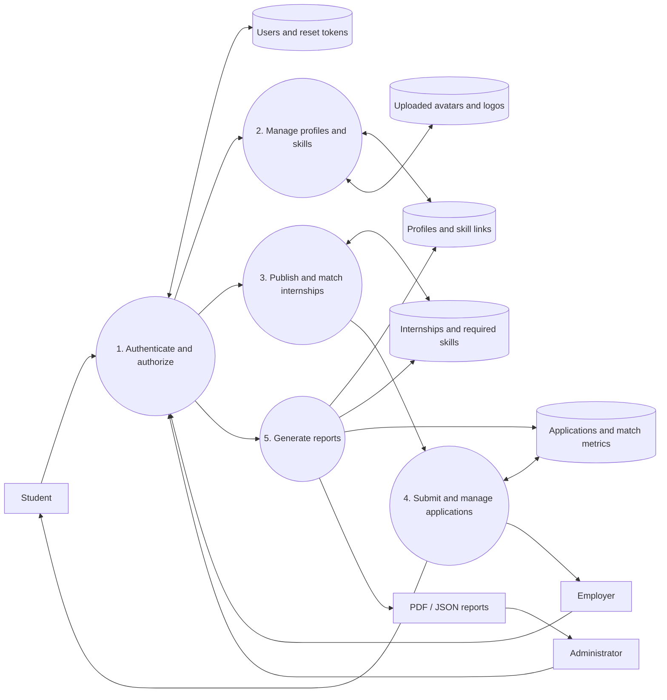

# SkillSync Security, Testing, and System Manual

> **Canonical documentation:** The current implementation-verified architecture, schema, API, installation, user, and developer references are now organized under [technical documentation](technical/README.md). This combined manual is retained for prior security/test notes; where it conflicts with the technical references or source code, use the technical references. For current test commands and case status, see [TESTING_STRATEGY.md](TESTING_STRATEGY.md) and [TEST_CASES.md](TEST_CASES.md).

**System:** SkillSync Internship and Skills Matching Platform
**Current implementation:** React + TypeScript/Vite client; Express + TypeScript API; Prisma ORM; SQLite by default
**Audience:** students, employers, administrators, developers, testers, and operators

## Contents

1. System Architecture
2. Diagrams
3. Security Controls
4. Database Schema Reference
5. API Reference
6. Installation Guide
7. User Manual
8. Technical Manual
9. Test Plan and Results

## 1. System Architecture

The browser application sends JSON requests to the Express API. The client uses same-origin `/api` routes and receives the session in an HttpOnly cookie. The API applies security headers, CORS, request rate limits, origin validation, body limits, authentication, role authorization, validation, and application logic before Prisma accesses SQLite. Avatar/logo files are stored in the server uploads directory.

### Components

| Component | Responsibility |
|---|---|
| React client | Student, employer, and administrator workflows; forms and visualizations. React renders text as escaped text by default. |
| Express API | Routing, middleware, validation, authentication, authorization, controllers, and JSON/PDF responses. |
| Security middleware | Helmet CSP, CORS, rate limiting, origin/Referer validation, JSON payload bounds, JWT verification. |
| Controllers/services | Domain operations, matching, readiness calculations, reporting, and PDF generation. |
| Prisma | Typed database access with parameterized queries and relational constraints. |
| SQLite | Persistent development database configured through `DATABASE_URL`. |
| Upload storage | Raster avatar/logo uploads under `server/uploads/avatars`; Multer applies size/MIME checks and the API verifies file signatures before writing. |

## 2. Diagrams

### 2.1 System Architecture Diagram



### 2.2 Entity Relationship Diagram

```mermaid
erDiagram
  User ||--o| StudentProfile : has
  User ||--o| EmployerProfile : has
  User ||--o{ PasswordResetToken : requests
  User ||--o{ Notification : receives
  StudentProfile ||--o{ StudentSkill : owns
  Skill ||--o{ StudentSkill : catalogues
  EmployerProfile ||--o{ Internship : posts
  Internship ||--o{ InternshipSkill : requires
  Skill ||--o{ InternshipSkill : catalogues
  StudentProfile ||--o{ Application : submits
  Internship ||--o{ Application : receives
  StudentProfile ||--o{ Recommendation : receives
  StudentProfile ||--o| StudentReadinessMetric : summarized_by
  Application ||--o| InternshipMatchMetric : summarized_by

  User {
    string id PK
    string email UK
    string password_hash
    string role
    datetime createdAt
    datetime updatedAt
  }
  StudentProfile {
    string id PK
    string userId FK_UK
    string firstName
    string lastName
    string university
    float gpa
    float readinessScore
  }
  EmployerProfile {
    string id PK
    string userId FK_UK
    string companyName
    string industry
  }
  Skill {
    string id PK
    string name UK
    string category
  }
  StudentSkill {
    string id PK
    string studentProfileId FK
    string skillId FK
    string proficiency
  }
  Internship {
    string id PK
    string employerProfileId FK
    string title
    string status
    datetime applicationDeadline
  }
  InternshipSkill {
    string id PK
    string internshipId FK
    string skillId FK
    int importance
  }
  Application {
    string id PK
    string studentProfileId FK
    string internshipId FK
    string status
    float matchScore
  }
  Recommendation {
    string id PK
    string studentProfileId FK
    string skillId
    string type
    int priority
  }
  Notification {
    string id PK
    string userId FK
    string type
    boolean isRead
  }
  AuditLog {
    string id PK
    string userId
    string action
    string entityType
    string entityId
  }
  PasswordResetToken {
    string id PK
    string userId FK
    string tokenHash UK
    datetime expiresAt
    boolean used
  }
  StudentReadinessMetric {
    string id PK
    string studentProfileId FK_UK
    float overallScore
  }
  InternshipMatchMetric {
    string id PK
    string applicationId FK_UK
    float overallMatch
  }
```

`AuditLog.userId` and `Recommendation.skillId` are nullable/unconstrained scalar fields in the current Prisma schema; they are not declared as Prisma relations. `AuditLog` currently has a model but the application does not yet write audit events automatically.

### 2.3 Use Case Diagram



### 2.4 Class Diagram



### 2.5 Authentication Sequence Diagram

```mermaid
sequenceDiagram
  actor User
  participant Client as React client
  participant API as Express API
  participant Auth as Auth controller
  participant DB as Prisma / database
  User->>Client: Submit email and password
  Client->>API: POST /api/auth/login (JSON)
  API->>API: CORS, rate limit, Origin and input validation
  API->>Auth: Validated request
  Auth->>DB: Find account by normalized email
  DB-->>Auth: User and password hash
  Auth->>Auth: bcrypt.compare and sign HS256 JWT
  Auth-->>API: User data; set HttpOnly SameSite cookie
  API-->>Client: 200; session cookie stored by browser
  Client->>API: GET /api/auth/me with cookie
  API->>API: Verify JWT and role as required
  API-->>Client: Current user profile
```

### 2.6 Application Activity Diagram



### 2.7 DFD Level 0 (Context Diagram)



### 2.8 DFD Level 1



## 3. Security Controls

### Authentication and password handling

- Passwords are hashed with `bcryptjs` at cost factor 12; plaintext passwords are not persisted.
- Registration and password reset require at least 12 characters, an uppercase letter, a lowercase letter, a number, and a non-whitespace special character. They retain the 72-character and 72 UTF-8-byte limits to avoid bcrypt's input truncation behavior. Login validates only the existing length/byte safeguards so existing accounts remain usable.
- JWTs use HS256 only, have an expiry, and require a configured `JWT_SECRET`; production secrets must be at least 32 characters.
- Browser sessions use `ss_token` with `HttpOnly`, `SameSite=Strict`, `/api` path, and `Secure` in production. The client no longer stores session tokens in localStorage.
- Bearer tokens remain supported for API clients. The server uses a generic invalid-credentials response.
- Password reset token values are stored as SHA-256 hashes and expire after one hour. Raw tokens are never returned by the API. Password reset cannot be completed until an email delivery provider is configured.
- Authentication endpoints are rate limited.

### Authorization and CSRF

- Student, employer, and administrator route groups use role checks. Platform-wide report routes require `ADMIN`.
- Unsafe requests with a browser `Origin` or `Referer` must match `CLIENT_URL`; cookie-authenticated unsafe requests must include one. Native bearer clients may omit these headers.
- `SameSite=Strict` is an additional browser control. Do not add cookie-authenticated clients that omit origin headers.

### Input, SQL injection, and XSS

- JSON bodies have a 1 MB parser limit, object-root requirement, maximum nesting, member-count and string-length limits, and reject prototype-pollution keys.
- Authentication and feature routes use shared `express-validator` rules for field types, lengths, formats, enums, numeric ranges, dates, identifiers, and pagination. Controllers continue enforcing business rules and ownership checks.
- Prisma's normal `find*`, `create`, `update`, and transaction APIs parameterize database values. Do not construct SQL by concatenating user input; no raw SQL API is used in the current server sources.
- Helmet applies a Content Security Policy and security headers. React escapes interpolated text by default. Do not use `dangerouslySetInnerHTML` for user-controlled data; link targets accept only HTTP(S) URLs.
- Avatar/logo uploads are size limited, checked against JPEG/PNG/WebP file signatures, and written with generated filenames/extensions. Production deployments should still serve user uploads from a separate origin or object store.

### Operational requirements

- Serve the site and API over HTTPS in production.
- Set `JWT_SECRET`, `DATABASE_URL`, `CLIENT_URL`, and `NODE_ENV=production`; use a managed secret store.
- Use a least-privilege database account and restrict database/network access.
- Audit logs are modeled but automatic audit-event writes are not currently wired in.
- Review dependency advisories with `npm audit` in both packages before release.

## 4. Database Schema Reference

Prisma source of truth: `server/prisma/schema.prisma`. The current provider is SQLite. Relational design separates user identity from role-specific profiles and models many-to-many skill associations through junction tables.

| Table | Primary key | Important columns and constraints | Relationships / indexes |
|---|---|---|---|
| `users` | `id` | unique `email`; password hash; role default `STUDENT`; timestamps | 1:1 optional student/employer profile; 1:N reset tokens and notifications; indexes email, role, createdAt |
| `password_reset_tokens` | `id` | unique `tokenHash`; `expiresAt`; `used` | FK user with cascade; indexes userId, used, expiresAt |
| `student_profiles` | `id` | unique `userId`; personal/education fields; optional GPA/year; readiness score | FK user cascade; skills, applications, recommendations, optional readiness metric; indexes university/city/score/createdAt |
| `employer_profiles` | `id` | unique `userId`; company name and organization fields | FK user cascade; 1:N internships; indexes companyName/industry/city/createdAt |
| `skills` | `id` | unique `name`; category; description/icon | 1:N student and internship skill links; index category/name |
| `student_skills` | `id` | proficiency, years experience, certification URL | FKs studentProfile/skill cascade; unique `(studentProfileId, skillId)`; indexes both FKs/proficiency |
| `internships` | `id` | title/description, remote flag, stipend/currency, dates, status | FK employer cascade; skills and applications; indexes employer/status/industry/remote/deadline/createdAt |
| `internship_skills` | `id` | importance and minimum level | FKs internship/skill cascade; unique `(internshipId, skillId)`; indexes both FKs/importance |
| `applications` | `id` | status, matchScore, cover letter, resume URL, dates | FKs student/internship cascade; unique `(studentProfileId, internshipId)`; optional match metric; indexes FKs/status/score/appliedAt |
| `recommendations` | `id` | type/title/description/resource/priority/completion | FK student profile cascade; `skillId` is currently an unconstrained optional scalar; indexes studentProfileId/createdAt |
| `notifications` | `id` | type/title/message/read state/action URL/timestamps | FK user cascade; indexes userId/isRead/createdAt |
| `audit_logs` | `id` | action/entity/change metadata/status/error | `userId` is currently nullable scalar without a declared FK; indexes userId/entityType/action/createdAt |
| `student_readiness_metrics` | `id` | scores and skill-gap count | unique studentProfileId; 1:1 relation; indexes overallScore/updatedAt |
| `internship_match_metrics` | `id` | component scores and overall match | unique applicationId; 1:1 relation; indexes applicationId/overallMatch |

### Normalization and integrity

- **1NF:** model attributes are scalar; repeatable student/internship skills are separate rows.
- **2NF:** junction-row facts depend on the full association; composite unique constraints prevent duplicate links/applications.
- **3NF:** catalog skills, users, role profiles, internships, and applications are separated to avoid transitive duplication.
- Primary keys use Prisma `cuid()` defaults. Foreign keys use `onDelete: Cascade` where declared.
- Enum-like values use `String` in SQLite and rely on application validation; database CHECK constraints are not defined in the current Prisma schema.
- `tags` remains a string field on Internship; if tags become queryable multi-valued data, normalize into an InternshipTag junction table.
- Metric models are persisted summary records; calculations and refresh cadence must be maintained by application logic.

## 5. API Reference

Base path: `/api`. JSON endpoints return `{ "success": boolean, "message"?: string, "data"?: ... }`. Authenticated browser calls use `withCredentials`; cookie sessions are created by register/login. API clients may send `Authorization: Bearer <JWT>`.

| Method and path | Access | Purpose |
|---|---|---|
| `POST /auth/register` | Public, rate limited | Create student or employer account; validates email, password, names and role |
| `POST /auth/login` | Public, rate limited | Authenticate and issue HttpOnly session cookie |
| `POST /auth/logout` | Public | Clear session cookie |
| `GET /auth/me` | Authenticated | Return current user/profile |
| `POST /auth/forgot-password` | Public, rate limited | Request reset token; response is non-enumerating |
| `POST /auth/reset-password` | Public, rate limited | Consume reset token and change password |
| `GET /student/profile` | Student | Read own profile and skills |
| `PUT /student/profile` | Student | Update own profile |
| `POST /student/profile/avatar` | Student | Upload avatar |
| `GET /student/readiness-score` | Student | Calculate readiness breakdown |
| `GET /student/skill-gap` | Student | View skill-gap analysis |
| `GET /student/recommendations` | Student | Read/generated recommendations |
| `PATCH /student/recommendations/:id/complete` | Student | Mark own recommendation complete |
| `GET /skills` | Public | List skill catalog |
| `GET /skills/my-skills` | Student | List own skills |
| `POST /skills/my-skills` | Student | Add skill |
| `PUT /skills/my-skills/:id` | Student | Update own skill |
| `DELETE /skills/my-skills/:id` | Student | Remove own skill |
| `GET /internships` | Public | Search/browse internships |
| `GET /internships/:id` | Public | Read internship |
| `GET /internships/recommended` | Student | List recommendations |
| `GET /internships/:internshipId/match-score` | Student | Calculate match score |
| `POST /applications` | Student | Submit application |
| `GET /applications/my-applications` | Student | List own applications |
| `PATCH /applications/:id/withdraw` | Student | Withdraw own application when allowed |
| `GET /employer/dashboard/stats` | Employer | Employer summary |
| `GET /employer/profile` | Employer | Read own company profile |
| `PUT /employer/profile` | Employer | Update own company profile |
| `POST /employer/profile/logo` | Employer | Upload company logo |
| `GET /employer/internships` | Employer | List own internships |
| `POST /employer/internships` | Employer | Create internship |
| `PUT /employer/internships/:id` | Employer | Update own internship |
| `DELETE /employer/internships/:id` | Employer | Delete own internship |
| `GET /employer/internships/:id/applicants` | Employer | Review own internship applicants |
| `PATCH /employer/applications/:id/status` | Employer | Update application status for own posting |
| `GET /admin/stats` | Admin | Platform summary |
| `GET /admin/analytics` | Admin | Platform analytics |
| `GET /admin/students` | Admin | List/search students |
| `GET /admin/employers` | Admin | List/search employers |
| `DELETE /admin/users/:id` | Admin | Delete user |
| `GET /admin/internships` | Admin | List internships |
| `PATCH /admin/internships/:id` | Admin | Update internship status/content |
| `DELETE /admin/internships/:id` | Admin | Delete internship |
| `GET /admin/applications` | Admin | List applications |
| `GET /admin/skills` | Admin | List skills |
| `POST /admin/skills` | Admin | Create skill |
| `PUT /admin/skills/:id` | Admin | Update skill |
| `DELETE /admin/skills/:id` | Admin | Delete skill |
| `GET /reports/dashboard` | Admin | Combined summary data |
| `GET /reports/student-readiness[/:studentId]` | Admin | Readiness data; `?export=pdf` downloads PDF |
| `GET /reports/internship-match` | Admin | Match data; PDF export supported |
| `GET /reports/application-statistics` | Admin | Application metrics; PDF export supported |
| `GET /reports/skills-demand` | Admin | Skills demand; PDF export supported |
| `GET /health` | Public | API health check |

Common status codes: `200` success, `201` created, `400` invalid input, `401` unauthenticated/invalid token, `403` origin/role denied, `404` missing resource, `409` duplicate, `429` rate limited, `500` unexpected server error. Report route authorization is administrator-only because those reports contain cross-user data.

## 6. Installation Guide

### Requirements

- Node.js 18 or later and npm.
- SQLite for local development. Production can use a Prisma-supported relational database after changing the datasource and provisioning an appropriate migration.
- Git and a terminal.

### Local setup (PowerShell)

```powershell
Set-Location server
npm install
```

Create `server/.env` with at least:

```env
DATABASE_URL="file:./dev.db"
JWT_SECRET="replace-with-a-random-secret-of-at-least-32-characters"
JWT_EXPIRES_IN="7d"
CLIENT_URL="http://localhost:5173"
PORT=5000
NODE_ENV="development"
```

Then generate the Prisma client and apply migrations:

```powershell
npx prisma generate
npx prisma migrate deploy
```

Start the API in one terminal:

```powershell
npm run dev
```

Start the client in another terminal:

```powershell
Set-Location client
npm install
npm run dev
```

Open the URL Vite prints (normally `http://localhost:5173`). Verify `GET http://localhost:5000/api/health`. Configure the frontend proxy and API base according to `client/vite.config.ts` for local development.

### Production checklist

1. Set `NODE_ENV=production`; provision a random `JWT_SECRET` of 32+ characters.
2. Set `DATABASE_URL` to the production database and use `npx prisma migrate deploy`.
3. Set `CLIENT_URL` to the exact HTTPS frontend origin(s), comma-separated if needed.
4. Serve the API behind HTTPS; the session cookie then receives `Secure`.
5. Build with `npm run build` in both `server` and `client` packages; deploy only generated client assets and server `dist` plus runtime dependencies.
6. Configure backups, monitoring, upload retention, rate limiting at the proxy, and dependency scanning.
7. Configure an email provider before enabling password reset in production; remove development-only reset-token exposure.

## 7. User Manual

### Student

1. Register with an email, a password of at least 12 characters containing uppercase and lowercase letters, a number, and a special character, first/last name, and account type Student.
2. Sign in. The browser stores the session as an HttpOnly cookie; JavaScript cannot read the token.
3. Complete education/contact details and add skills with proficiency.
4. Browse internships, open a position, review requirements, and submit an application.
5. View match/readiness information, recommendations, and application status from the student dashboard.
6. Withdraw an application only while its status permits withdrawal.
7. Sign out using the account menu; the API clears the session cookie.

### Employer

1. Register as Employer with company name and user details.
2. Complete company profile and upload a JPEG/PNG/WebP logo within the upload size limit.
3. Create an internship with dates, location/remote setting, description, and required skills.
4. Review applicants for your own internship and update their status.
5. Maintain postings and review employer dashboard statistics.

### Administrator

1. Sign in using an administrator account provisioned through approved administration procedures; public registration does not create administrator accounts.
2. Manage users, internships, and the skills catalog from the admin navigation.
3. Open Reports to review readiness, match, application, and demand reports.
4. Use the PDF export action for an individual report.
5. Protect downloaded reports as they contain platform-wide information.

## 8. Technical Manual

### Backend layout

- `server/src/index.ts`: middleware registration and route mounting.
- `server/src/routes`: route definitions and route-level roles/validators.
- `server/src/controllers`: HTTP-level input extraction and responses.
- `server/src/services`: matching and report business logic.
- `server/src/middleware/auth.ts`: JWT session and role middleware.
- `server/src/middleware/security.ts`: Origin and JSON body guards.
- `server/src/utils/jwt.ts`: HS256 signing and verification.
- `server/src/utils/authCookie.ts`: HttpOnly cookie attributes.
- `server/prisma/schema.prisma`: database model source of truth.
- `server/prisma/migrations`: ordered database changes.

### Client layout

- `client/src/contexts/AuthContext.tsx`: user state and session restoration.
- `client/src/services/api.ts`: API client with browser credentials enabled.
- `client/src/components/layout`: role-based application layouts and navigation.
- `client/src/pages`: student, employer, and admin screens.

### Security-sensitive conventions

- Keep auth cookie scoped to `/api`; never put session JWTs in `localStorage` or return them in browser JSON responses.
- All state-changing cookie-authenticated requests require a configured Origin or Referer. Preserve `withCredentials: true` on browser API clients.
- Add an `authorize(...)` middleware at the route boundary before role-specific controllers.
- Use express-validator for endpoint-specific constraints and continue validating ownership in the controller/query predicate.
- Use Prisma client operations; if raw SQL is introduced, use tagged `$queryRaw`/`$executeRaw` with placeholders and code review.
- Render user content as text. Do not introduce HTML injection sinks. Validate redirect/link URLs against approved schemes.
- Do not expose error stack traces or internal report errors in API responses. Keep API error messages generic for authentication.
- Store uploaded assets outside executable/static application code in production and validate file content, not only the browser-supplied MIME type.

### Useful commands

```powershell
# Server build and automated security tests
Set-Location server
npm run build
npm test

# Prisma client/schema tools
npx prisma generate
npx prisma validate
npx prisma migrate status

# Client build
Set-Location ..\client
npm run build
```

## 9. Test Plan and Results

### Test types

- **Unit tests:** exercise a single middleware/helper or policy in isolation.
- **Integration tests:** run multiple Express middleware components over HTTP and verify responses.
- **System tests:** exercise a complete user workflow across browser, API, and database. The cases below are test procedures; they require a seeded database and running client/API.

Run backend automated tests from `server/` with `npm test`. The script builds TypeScript and discovers all server tests using Node's built-in test runner. Focused commands are `npm run test:unit` and `npm run test:integration`. See [TESTING_STRATEGY.md](TESTING_STRATEGY.md) and [TEST_CASES.md](TEST_CASES.md) for the full plan and case register.

### Automated test cases

| ID | Type | Test | Expected result | Actual result (latest run) |
|---|---|---|---|---|
| SEC-001 | Integration | POST from configured Origin | Request proceeds to handler | PASS, 200 |
| SEC-002 | Integration | POST from unapproved Origin | Request rejected | PASS, 403 |
| SEC-003 | Integration | Cookie-authenticated unsafe request with no Origin/Referer | Request rejected | PASS, 403 |
| VAL-001 | Integration | JSON array at body root | Request rejected as invalid JSON shape | PASS, 400 |
| VAL-002 | Integration | JSON body containing `__proto__` key | Request rejected | PASS, 400 |
| AUTH-001 | Integration | Call protected admin route without credentials | Request rejected | PASS, 401 |
| RBAC-001 | Integration | Student token calls admin route | Request rejected | PASS, 403 |
| RBAC-002 | Integration | Admin token calls admin route | Request allowed | PASS, 200 |
| AUTH-002 | Integration | Valid administrator HttpOnly cookie | Request allowed | PASS, 200 |
| RBAC-003 | Integration | Student calls platform-wide reports route | Request rejected | PASS, 403 |
| AUTH-003 | Unit | Create auth cookie | HttpOnly, SameSite strict, `/api` path set | PASS |
| AUTH-004 | Unit | Hash and verify a password | Hash differs from plaintext; correct password matches and incorrect password fails | PASS |
| VAL-003 | Integration | Register with malformed email/short password | 400; secret input is not reflected in response | PASS, 400 |
| RBAC-004 | Integration | Public registration requests `ADMIN` role | 400; administrator account is not created | PASS, 400 |
| ID-001 | Integration | Register with malformed names or university values | 400; no account created for invalid input | PASS, 400 |
| ID-002 | Database integration | Register international names and a university with surrounding whitespace | Account created with trimmed identity fields; password remains hashed | PASS, 201 |

**Latest actual results (2026-10-20):** 102 server tests passed, 0 failed, and 0 skipped with a dedicated isolated SQLite test database configured; focused registration/security tests passed 33/33. Client tests passed 24/24. Server TypeScript build and client `npm run build` passed; Vite reported a non-blocking large-chunk warning. The temporary test database was cleaned up. These results do not imply browser verification or replace full system tests.

### System test procedures (execute with seeded accounts/data)

| ID | Type | Test steps | Expected result | Actual result |
|---|---|---|---|---|
| SYS-001 | System | Register a student with a valid password; inspect response and browser storage | Account created; HttpOnly cookie set; JWT absent from JSON and localStorage | Pending execution |
| SYS-002 | System | Register with invalid email, short password, or role `ADMIN` | 400 validation response; account not created; administrator role not granted | Pending execution |
| SYS-003 | System | Sign in, refresh page, then call `/api/auth/me` | Session restored from HttpOnly cookie | Pending execution |
| SYS-004 | System | Submit mutation from an unapproved origin with session cookie | 403 and no data mutation | Pending execution |
| SYS-005 | System | Student opens admin pages/reports API | 403; no platform-wide data returned | Pending execution |
| SYS-006 | System | Employer updates another employer's internship | Request denied/not found; no other employer data changed | Pending execution |
| SYS-007 | System | Student applies twice to one active internship | First succeeds; duplicate rejected with 409 | Pending execution |
| SYS-008 | System | Admin exports a report as PDF | `application/pdf` attachment downloads with expected report data | Pending execution |
| SYS-009 | System | Upload unsupported or oversized avatar | Upload rejected; no file stored | Pending execution |
| SYS-010 | System | Render profile text containing `<script>` as ordinary text | Markup is displayed as text and never executed | Pending execution |

### Actual results template

Copy one row per execution; record environment and evidence without including secrets or personal data.

| Field | Value |
|---|---|
| Test ID / title |  |
| Build / commit |  |
| Environment and browser |  |
| Preconditions / test account role |  |
| Steps executed |  |
| Expected result |  |
| Actual result |  |
| Pass / fail / blocked |  |
| Evidence reference (redacted) |  |
| Defect ID / notes |  |

### Test-data safety

Use synthetic accounts and non-production data. Never place plaintext passwords, reset tokens, production JWTs, or personal records in test logs or screenshots.
