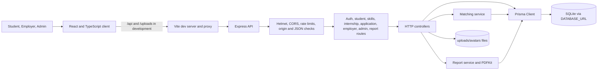
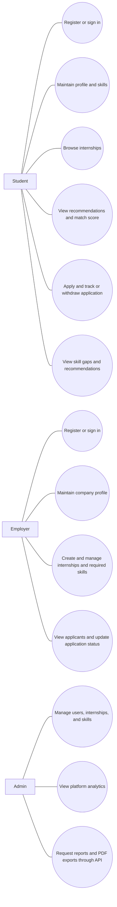
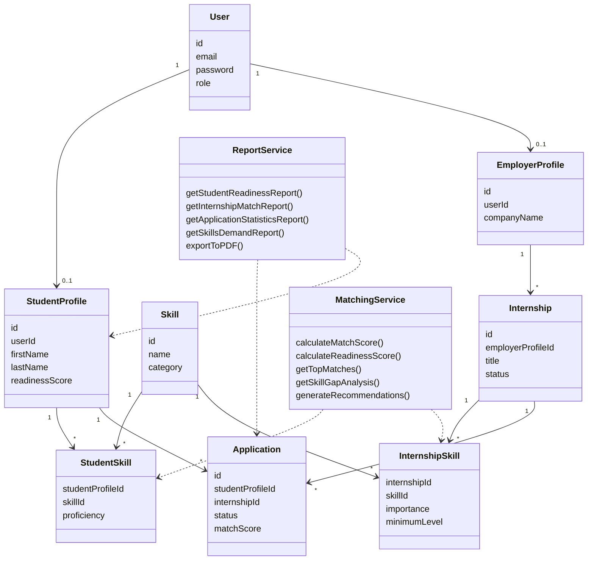
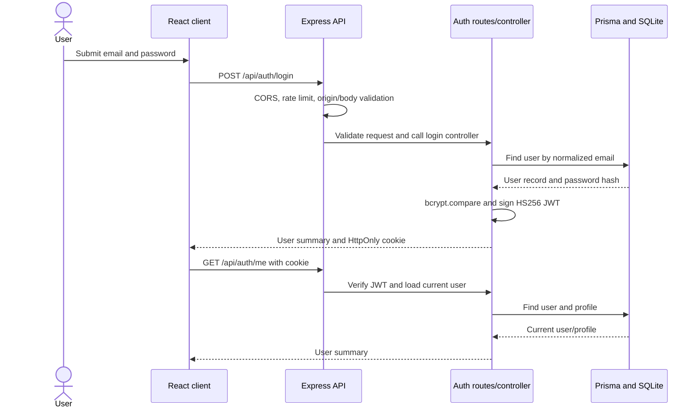
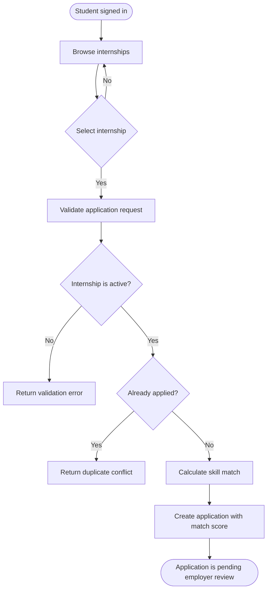
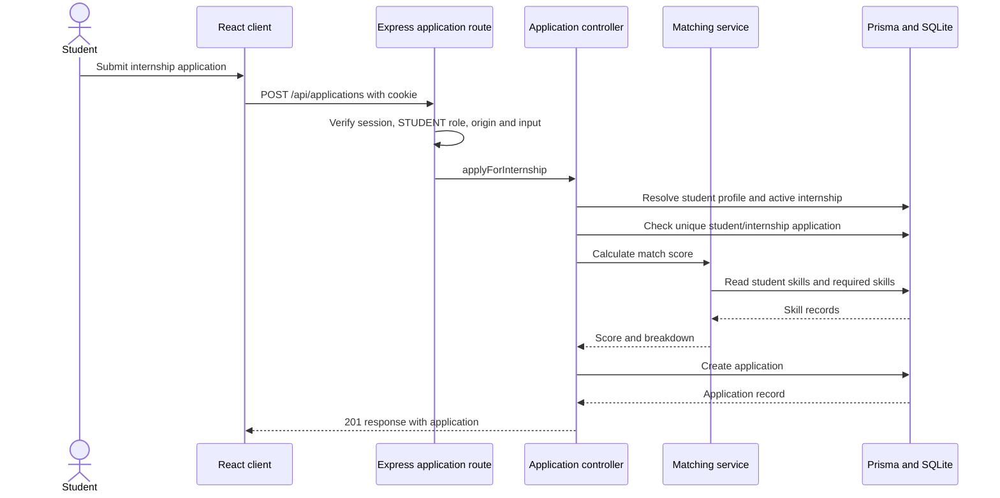
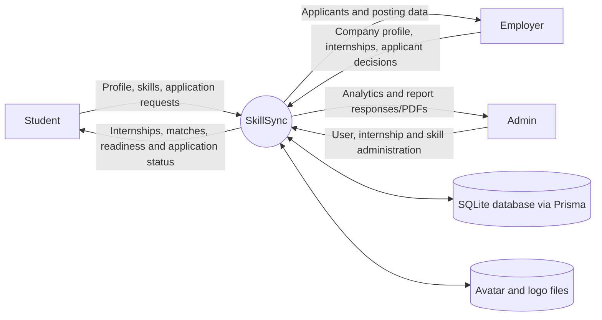
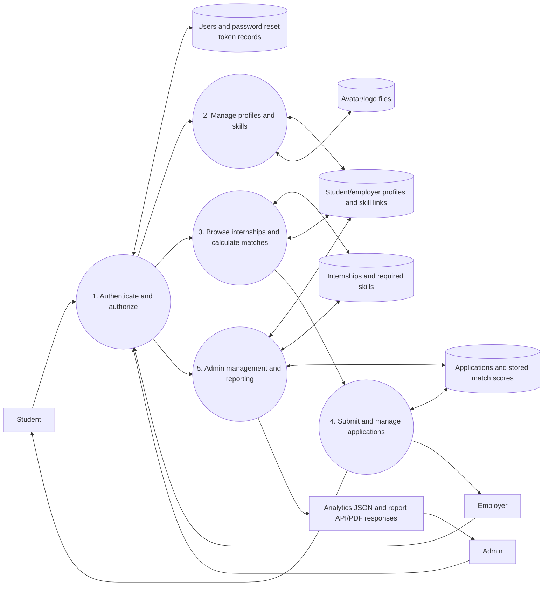

# Architecture and Diagrams

## System Architecture

In development, Vite serves the React client on port 5173 and proxies `/api` and `/uploads` to the Express server, normally on port 5000. The Express server applies Helmet, CORS, rate limiting, request-origin checks, body parsing, and JSON-body validation before mounting the API routers. Controllers use Prisma; matching and report calculations use server services. Avatar/logo files are stored under the server uploads directory and served from `/uploads`.

This diagram shows the configured local arrangement. A production reverse proxy, separate object store, PostgreSQL/Supabase backend, email provider, and deployment topology are not defined in the repository.

## Use Case Diagram

Admin report requests exist in the API. The client currently exposes Analytics, not a dedicated Reports page.

## Conceptual Class Diagram

The data classes are Prisma models, not hand-written TypeScript domain classes. Service/controller nodes reflect actual server modules.

## Authentication Sequence

Registration uses the same cookie session pattern after creating a student or employer account. Public registration does not create admins.

## Application Activity

## Application Sequence

## DFD Level 0

## DFD Level 1

This DFD does not include notification delivery, audit-event processing, email reset delivery, or a separate reporting UI because those workflows are not wired into the current application.